# Manual paso a paso — Configuración de Flujo de Aprobación por Ámbitos

**Módulo:** Admin Logística → Flujo por Niveles (`/admin-logistica/config-flujo-aprobacion`)
**Rol requerido:** `ADLOGIST` o `TILOGIST`
**Caso real documentado:** Hass Perú S.A. (20481121966) — ámbito FUNDO *Fundo Hass Peru* (0801), habilitación del área **OPERACIONES** con **Luisa Gutierrez (DNI 47857722)** como aprobador N1.
**Ejemplo desde cero:** Berry Harvest S.A. (20610773274) — ámbito FUNDO *Fundo Berry - Dg* (0601) creado desde la pantalla.

> Regla de oro: el campo **"Motivo del cambio"** es obligatorio para *cualquier* guardado, publicación o inactivación. Si el botón aparece deshabilitado, casi siempre es porque el motivo está vacío.

---

## 0. Conceptos clave

| Concepto | Qué es |
|---|---|
| **Ámbito organizacional** | Unidad que agrupa áreas: `ADMINISTRATIVO` (código/nombre libre) o `FUNDO` (se elige del **maestro de fundos** de la empresa, código y nombre quedan de solo lectura). |
| **Área en ámbito** | Vínculo entre el ámbito y un área del **catálogo de la empresa** (`LOGISTICA_Areas`). El área debe existir previamente en el menú *Áreas* y no estar eliminada. |
| **Asignación** | Autorización de una persona (DNI) en un área-ámbito con permisos: *Crear requerimientos*, *Aprobar N1*, *Aprobar N2*. Con vigencia Desde/Hasta. |
| **Regla** | Define niveles (1 o 2) y responsables (titulares y suplentes por orden) para un tipo de requerimiento (CONSUMO/COMPRA/SERVICIO). Estados: `BORRADOR → PUBLICADA → INACTIVA`. |
| **Precedencia de reglas** | Gana la más específica: **área específica > ámbito específico > todo el tipo** (`idarea` pesa 1 + `idAmbito` pesa 2). |
| **Resolución N1/N2** | El motor toma el responsable de menor *orden* disponible y vigente de la regla, **que además tenga la asignación con el permiso correspondiente en el área-ámbito del solicitante**. N2 debe ser distinto del solicitante y del N1. |
| **Despliegue** | Interruptor por empresa. Solo se activa si existe al menos una regla `PUBLICADA`. Mientras esté inactivo, todo sigue el flujo anterior. |

---

## 1. Seleccionar la empresa

En la parte superior de la pantalla se listan las empresas del administrador. Seleccione la empresa a configurar (queda en verde).

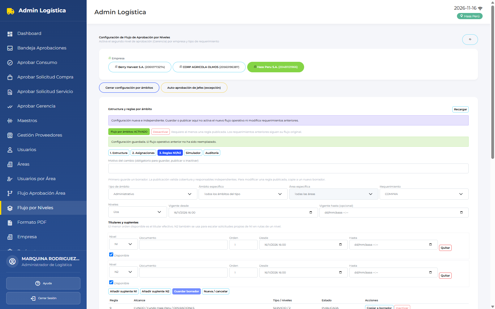

El badge **"Flujo por ámbitos: ACTIVADO / INACTIVO"** muestra si el nuevo flujo ya está habilitado para esa empresa.

---

## 2. Pestaña 1 · Estructura

### 2.1 Crear un ámbito tipo FUNDO

1. Escriba el **motivo del cambio**.
2. En *Tipo* elija **Fundo**. Aparece el selector *"Fundo del maestro de la empresa"*.
   - Si dice *"La empresa no tiene fundos registrados en el maestro"* → primero registre el fundo en el maestro.
   - Si dice *"No se pudo consultar el maestro de fundos"* → use *Reintentar*; **no** se permite registro manual.
3. Seleccione el fundo: el **Código** y el **Nombre** se completan solos (solo lectura).
4. Deje *Activo* marcado y pulse **Guardar ámbito**.

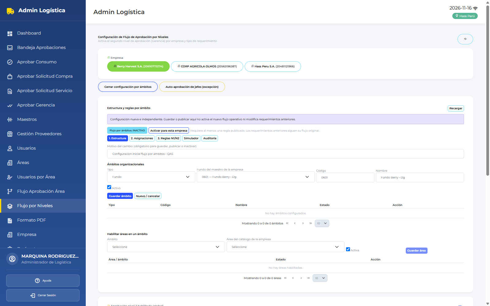
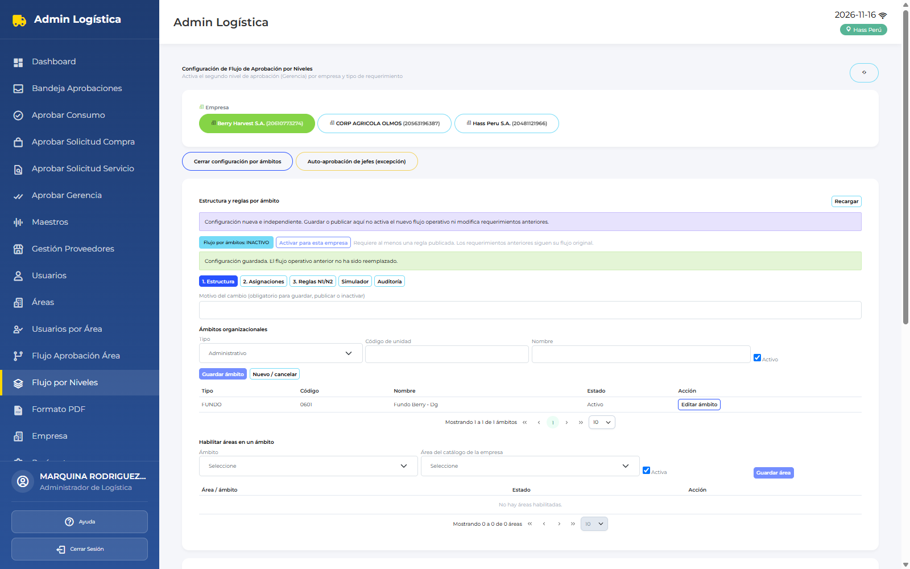

> Un ámbito `ADMINISTRATIVO` se crea igual, pero escribiendo código y nombre a mano. Tipo, código y fundo maestro son **inmutables** una vez guardados (solo se edita nombre y estado).

### 2.2 Habilitar áreas en el ámbito

1. *Ámbito*: elija `FUNDO / Fundo Hass Peru`.
2. *Área del catálogo de la empresa*: elija el área (p. ej. **OPERACIONES**). Si el área no aparece, créela antes en el menú **Áreas**.
3. Marque *Activa*, escriba el motivo y pulse **Guardar área**.

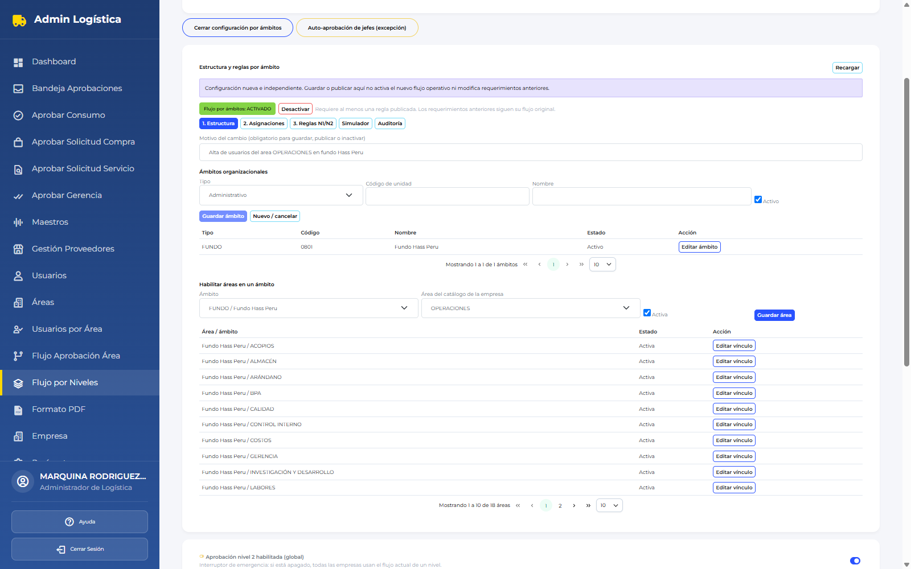
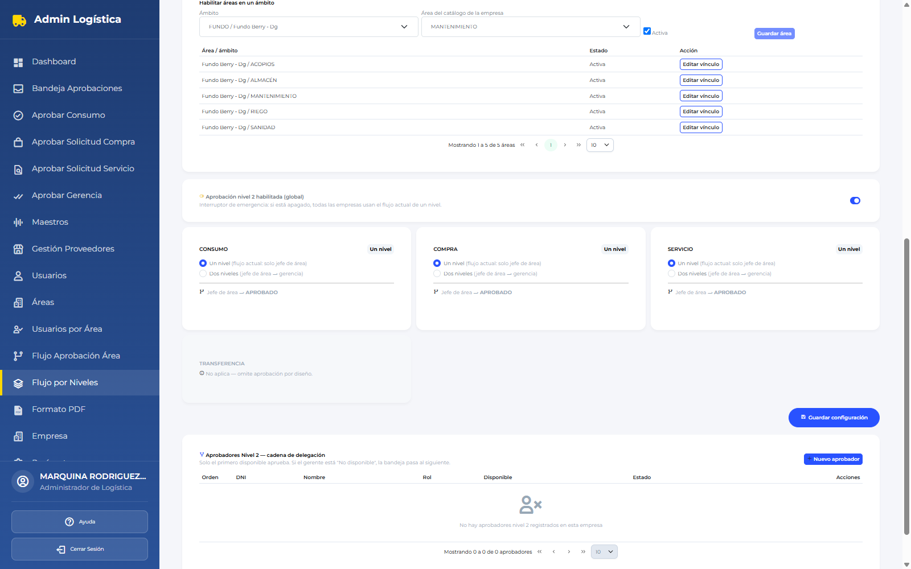

**Notas:**
- Si el vínculo ámbito+área ya existe, "Guardar área" solo actualiza el estado (no duplica ni da error).
- No se puede desactivar un vínculo con asignaciones activas o reglas publicadas que lo cubran.
- Si el ámbito está inactivo no se puede habilitar un área activa en él.

---

## 3. Pestaña 2 · Asignaciones

Autoriza personas por área-ámbito. Una misma persona puede tener permisos en varias empresas/áreas; ser aprobador no impide solicitar.

1. *Área y ámbito*: `Fundo Hass Peru / OPERACIONES`.
2. *Documento de identidad*: DNI de la persona (debe existir como usuario).
3. *Desde*: fecha de inicio de la autorización. **Ojo:** si la persona es responsable de una regla publicada cuya vigencia inició antes, el `Desde` debe ser **igual o anterior** a esa fecha (en Hass Perú las reglas cargadas por Excel inician `2026-01-01`; si pone hoy, el sistema rechaza con *"La modificación dejaría sin autorización un responsable de una regla publicada"*).
4. Permisos: *Crear requerimientos*, *Aprobar N1*, *Aprobar N2*, *Asignación activa*.
5. Motivo y **Guardar asignación**.

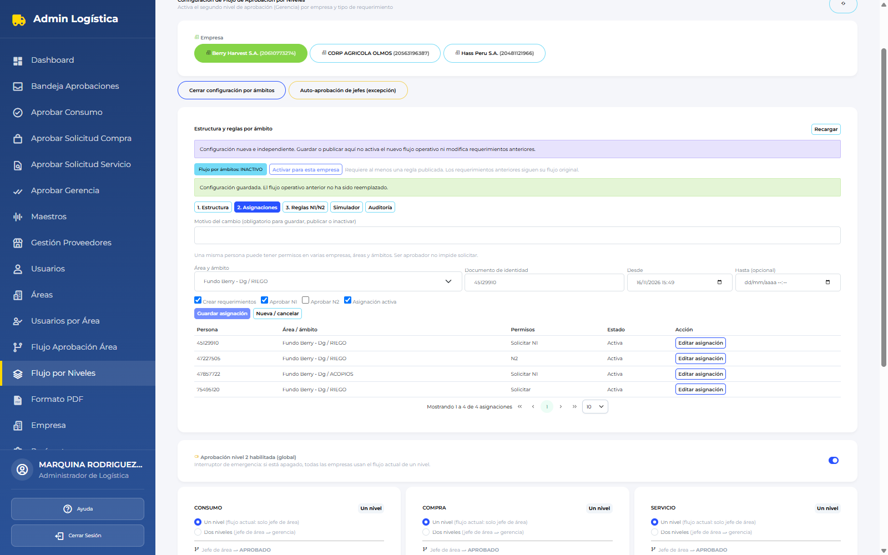

### Asignaciones reales creadas para OPERACIONES (Hass Perú)

| DNI | Nombre | Permisos | Desde |
|---|---|---|---|
| 47857722 | GUTIERREZ GUZMAN LUISA MARIA (jefa de área) | Solicitar + **N1** | 01/01/2026 |
| 18030143 | Aprobador corporativo | **N1 + N2** (requerido por ser responsable N1 suplente en reglas ya publicadas) | 01/01/2026 |
| 40181633 | Aprobador corporativo | **N1 + N2** (ídem) | 01/01/2026 |

> Detalle importante: si una persona figura como responsable N1 en una regla `PUBLICADA` que cubre el área, su asignación **debe incluir también el permiso N1** (y lo mismo para N2). Por eso 18030143 y 40181633 no pudieron registrarse solo con N2.

---

## 4. Pestaña 3 · Reglas N1/N2

Flujo: **guardar BORRADOR → revisar → PUBLICAR**. Una regla publicada no se edita: se *copia a borrador* y se publica la nueva versión.

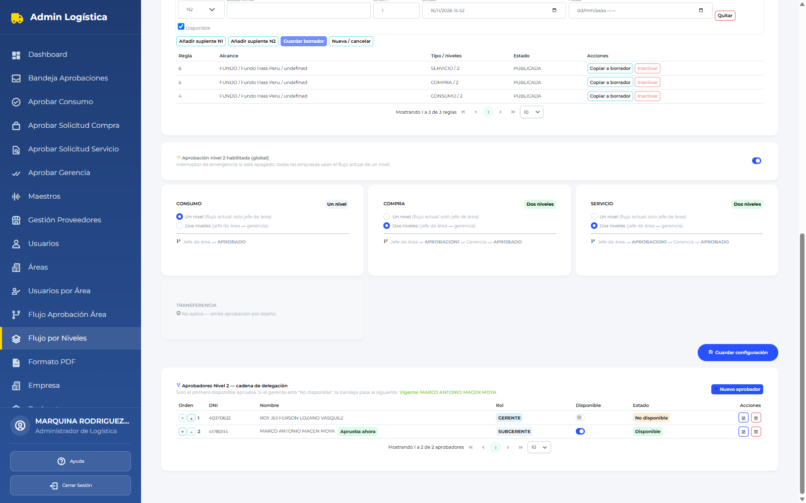

### 4.1 Crear el borrador

1. *Tipo de ámbito*: `Fundo`.
2. *Ámbito específico*: `Fundo Hass Peru` (o "Todos los ámbitos del tipo" para regla global).
3. *Área específica*: `OPERACIONES` (o "Todas las áreas").
4. *Requerimiento*: `CONSUMO` / `COMPRA` / `SERVICIO`.
5. *Niveles*: `Dos` (jefe de área → gerencia) o `Uno` (solo jefe de área).
6. *Vigente desde*: fecha de inicio.
7. **Titulares y suplentes**: cada fila es un responsable con Nivel (N1/N2), Documento, Orden, vigencia y *Disponible*. Use **"Añadir suplente N1 / N2"** para agregar filas (el orden se autonumera). El menor orden disponible es el titular efectivo.
8. Motivo y **Guardar borrador**.

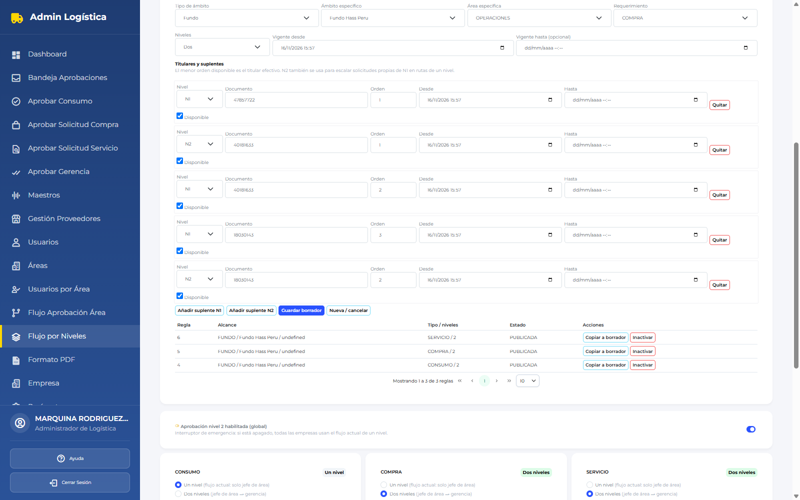

### Reglas publicadas para OPERACIONES (Hass Perú) — con data real

Para que **47857722** sea la N1 efectiva de OPERACIONES se crearon 3 reglas específicas por área (las reglas globales del ámbito ponían antes a responsables corporativos con mejor orden):

| Regla | Alcance | Tipo | N1 (orden) | N2 (orden) | Estado |
|---|---|---|---|---|---|
| 7 | FUNDO / Fundo Hass Peru / OPERACIONES | COMPRA | 47857722 (1), 40181633 (2), 18030143 (3) | 40181633 (1), 18030143 (2) | PUBLICADA |
| 8 | FUNDO / Fundo Hass Peru / OPERACIONES | CONSUMO | igual | igual | PUBLICADA |
| 9 | FUNDO / Fundo Hass Peru / OPERACIONES | SERVICIO | igual | igual | PUBLICADA |

Las reglas 4, 5 y 6 (ámbito completo, todas las áreas) siguen vigentes para el resto de áreas.

### 4.2 Publicar

Con el motivo escrito, pulse **Publicar** en la fila del borrador. El sistema valida:

- Que no exista **otra regla publicada del mismo alcance** con vigencia superpuesta.
- Que **todas las áreas cubiertas** tengan al menos un responsable N1 con asignación `puedeAprobarN1` vigente **en esa área** → error: *"Hay áreas sin N1 autorizado y disponible al inicio de vigencia"*.
- En reglas de 2 niveles, que exista un **N2 independiente** (distinto del N1 titular) con `puedeAprobarN2` en el área → error: *"Hay áreas sin responsables N1 y N2 independientes y vigentes"*.

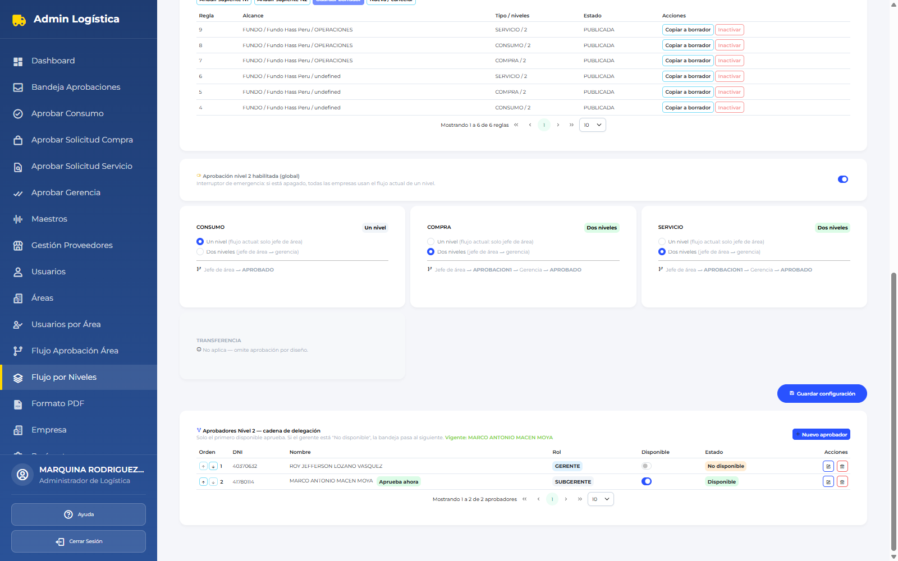

---

## 5. Pestaña 4 · Simulador

Prueba la ruta sin crear aprobaciones ni modificar requerimientos.

1. *Área / ámbito*: `Fundo Hass Peru / OPERACIONES`.
2. *Solicitante*: DNI (debe tener `puedeSolicitar` en esa área-ámbito).
3. *Tipo*: CONSUMO/COMPRA/SERVICIO → **Simular ruta**.

**Antes de las reglas por área** (resolvía con la regla global del ámbito → N1 corporativo):

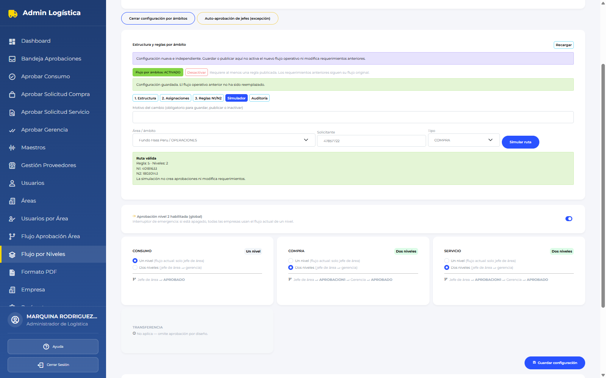

**Después** (regla específica 7 → **N1 = 47857722**, N2 = 40181633):

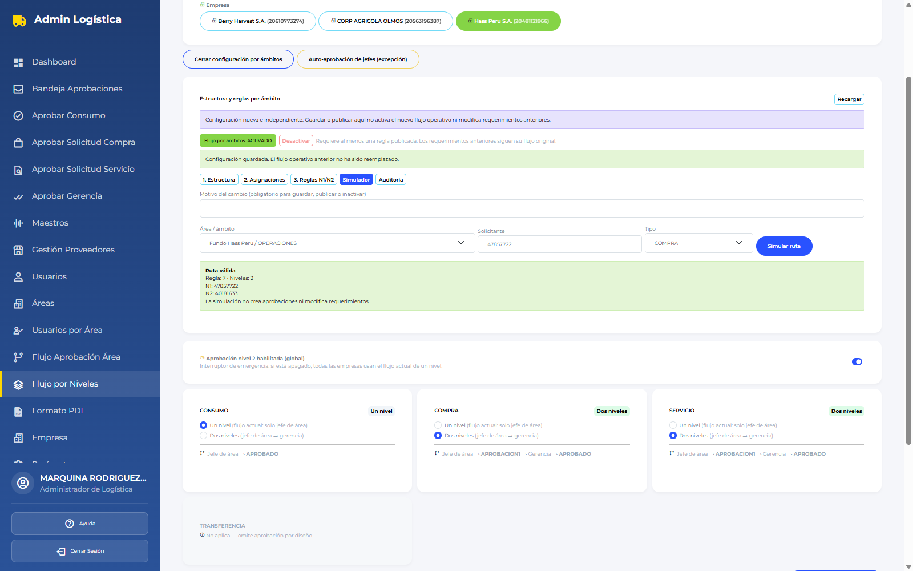

**Mensajes posibles:**
- `Ruta válida` — muestra regla usada, niveles, N1 (o *"se omite por solicitud propia"* si el solicitante es el N1) y N2.
- `El solicitante no está autorizado en esta área y ámbito` — falta asignación con `puedeSolicitar`.
- `No existe una ruta publicada para este requerimiento` — no hay regla publicada que cubra ese alcance.
- `No existe un aprobador N1/N2 autorizado y disponible` — los responsables de la regla no tienen la asignación con el permiso en esa área.

---

## 6. Pestaña 5 · Auditoría

Cada guardado/publicación registra: fecha, entidad e ID, acción (`GUARDAR`, `GUARDAR_BORRADOR`, `PUBLICADA`, `INACTIVA`, `CAMBIAR_ESTADO`), usuario y motivo. Sirve para reconstruir quién cambió qué y por qué.

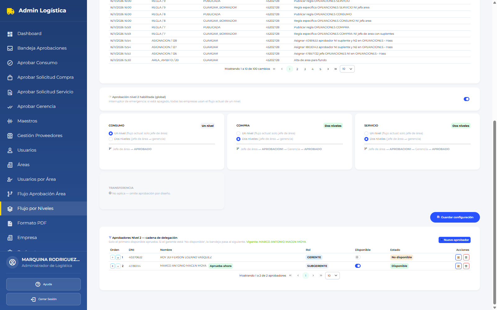

---

## 7. Activar el flujo (despliegue)

Con al menos una regla `PUBLICADA` y el motivo escrito, pulse **"Activar para esta empresa"**. El badge pasa a `Flujo por ámbitos: ACTIVADO`. Los requerimientos anteriores siguen su flujo original; los nuevos usan las reglas por ámbito. *Desactivar* revierte el interruptor (con motivo).

---

## 8. Errores frecuentes

| Error | Causa | Solución |
|---|---|---|
| Botón Guardar deshabilitado | Falta motivo, ámbito/área en "Seleccione" | Escribir el motivo y completar los combos |
| *Área no válida para esta empresa* | El área no existe en `LOGISTICA_Areas` del RUC o está eliminada | Crearla en menú **Áreas** primero |
| *Ámbito no válido para esta empresa* | Ámbito inactivo y se guardaba un vínculo activo | Activar el ámbito o guardar el vínculo inactivo |
| *La modificación dejaría sin autorización un responsable de una regla publicada* | La asignación quita N1/N2 a un responsable, lo inactiva, o su `Desde` es posterior al inicio de vigencia del responsable | Incluir el permiso correspondiente y poner `Desde` ≤ inicio de vigencia de la regla |
| *Hay áreas sin N1 autorizado…* al publicar | Alguna área cubierta no tiene responsable N1 con permiso en esa área | Asignar `puedeAprobarN1` en cada área cubierta o acotar el alcance de la regla |
| *Existe otra regla publicada del mismo alcance con vigencia superpuesta* | Duplicidad de alcance+vigencia | Inactivar la anterior o ajustar vigencias |
| *La configuración está siendo modificada* | Lock de concurrencia (10 s) | Reintentar |
| *El área tiene asignaciones activas o reglas publicadas* | Al desactivar vínculo área-ámbito | Primero inactivar asignaciones/reglas que la cubren |
| `El solicitante no está autorizado` (simulador) | Falta asignación `puedeSolicitar` en esa área-ámbito | Crear la asignación |

---

## 9. Checklist final

- [ ] Empresa seleccionada correcta
- [ ] Ámbito FUNDO creado desde el **maestro de fundos** (activo)
- [ ] Áreas del catálogo habilitadas en el ámbito (activas)
- [ ] Solicitantes con `puedeSolicitar` por área-ámbito
- [ ] Jefes/aprobadores con `puedeAprobarN1` y corporativos con `puedeAprobarN2` por área-ámbito, con vigencia desde el inicio de la regla
- [ ] Reglas guardadas como BORRADOR y luego PUBLICADAS (global por ámbito y/o específicas por área)
- [ ] Simulación `Ruta válida` con N1/N2 esperados
- [ ] Auditoría muestra los cambios con motivo
- [ ] `Flujo por ámbitos: ACTIVADO`

---

## 10. Estado resultante en QAS (16/11/2026)

**Hass Perú (20481121966)** — completo:
- Ámbito `FUNDO / Fundo Hass Peru (0801)` con 18 áreas habilitadas, incluida OPERACIONES.
- OPERACIONES: asignaciones de 47857722 (solicitar+N1), 18030143 y 40181633 (N1+N2).
- Reglas publicadas: 3 globales del ámbito (ids 4-6) + 3 específicas de OPERACIONES (ids 7-9).
- Despliegue **ACTIVADO**. Simulación COMPRA/OPERACIONES → Regla 7, N1=47857722, N2=40181633.

**Berry Harvest (20610773274)** — ejemplo desde cero (manual):
- Ámbito `FUNDO / Fundo Berry - Dg (0601)` creado por pantalla con 5 áreas habilitadas (RIEGO, SANIDAD, ACOPIOS, ALMACÉN, MANTENIMIENTO) y asignaciones de usuarios reales. **Sin reglas publicadas aún** → el flujo nuevo aún no opera (correcto para dejarlo como referencia de pasos 1-2).

**CORP AGRICOLA OLMOS (20563196387)** — réplica completa, flujo ya operativo:
- Ámbito `FUNDO / Fundo Cao - Cs (1001)` con las 8 áreas del catálogo habilitadas.
- Asignaciones reales: RIEGO → 46830794 Crosber (solicitar+N1), 77062749 Gary (solicitar), 18030143 y 40181633 (N1+N2 corporativo); ALMACÉN → 73673693 Kathya (solicitar+N1), 18030143 y 40181633 (N1+N2).
- Reglas publicadas por área (N1 del jefe del área + suplentes corporativos): RIEGO ids 10-12, ALMACÉN ids 13-15. Las demás áreas quedan sin regla hasta que tengan jefes asignados.
- Despliegue **ACTIVADO**. Simulación COMPRA/RIEGO con solicitante 77062749 → Regla 11, N1=46830794, N2=40181633.

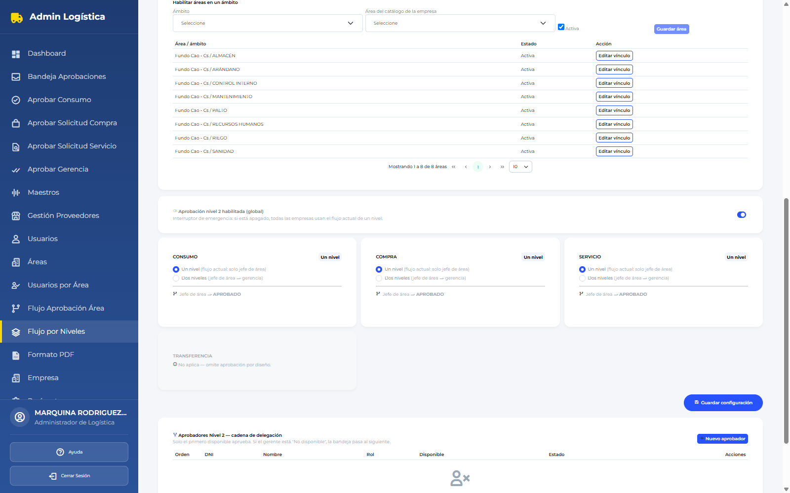
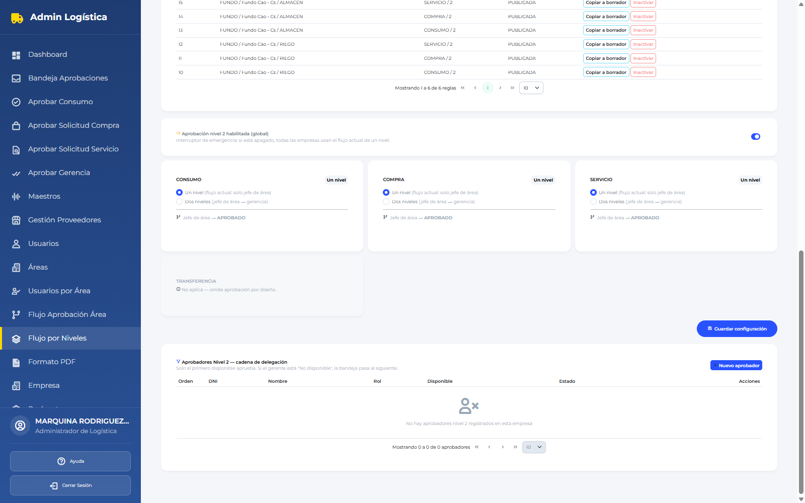
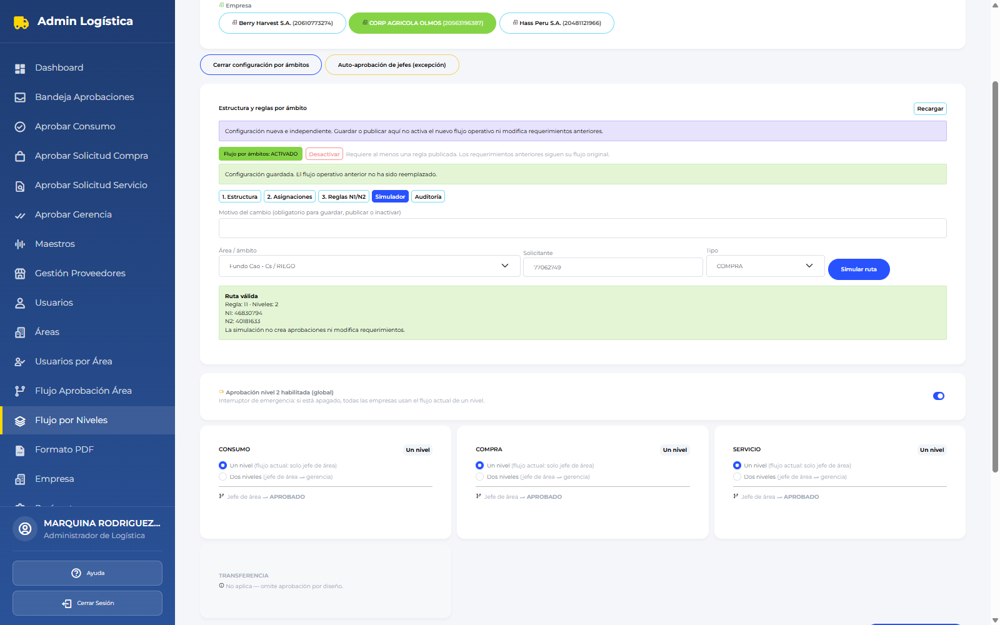
