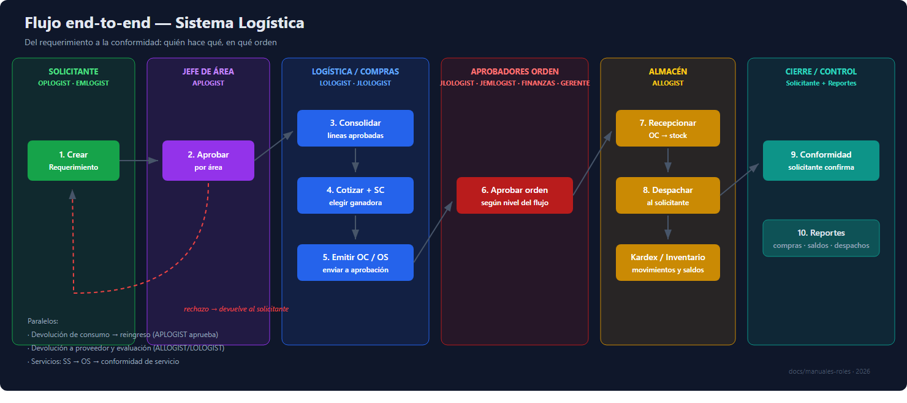

# Diagrama del Flujo End-to-End — Sistema Logística

*(Versión vectorial para proyección: [diagrama-flujo.svg](diagrama-flujo.svg))*

## Lectura del diagrama

| Nº | Paso | Rol | Pantalla |
|---|---|---|---|
| 1 | Crear requerimiento | OPLOGIST · EMLOGIST · LOLOGIST · ALLOGIST · ADLOGIST · JLOLOGIST | Requerimientos |
| 2 | Aprobar por área | APLOGIST (+ ADLOGIST, JLOLOGIST) | Aprobaciones por Área |
| 3 | Consolidar líneas | LOLOGIST (+ JLOLOGIST, ADLOGIST) | Consolidación |
| 4 | Cotizar + SC | LOLOGIST | Cotizaciones / Solicitudes de Compra |
| 5 | Emitir OC / OS | LOLOGIST | Órdenes de Compra / Servicio |
| 6 | Aprobar orden | JLOLOGIST · JEMLOGIST · FINANZAS · GERENTE | Aprobación OC / OS |
| 7 | Recepcionar | ALLOGIST · LOLOGIST | Recepción de Mercadería |
| 8 | Despachar | ALLOGIST · LOLOGIST | Despachos |
| 9 | Conformidad | Solicitante | Conformidad de Despacho / Servicios |
| 10 | Reportes | Según rol | Reportes |

## Flujos paralelos

- **Devolución de consumo → reingreso**: usuario devuelve → APLOGIST aprueba → ALLOGIST reingresa a stock.
- **Devolución a proveedor**: ALLOGIST devuelve mercadería defectuosa o en exceso.
- **Evaluación de proveedores**: ALLOGIST/LOLOGIST califican desempeño tras la recepción.
- **Servicios**: SS → OS → conformidad de servicio (no pasa por almacén).

## Uso sugerido

- Proyección en capacitaciones (abrir `diagrama-flujo.svg` en el navegador a pantalla completa).
- Impresión tamaño A4/A3 para almacén y oficinas.
- Referencia rápida dentro del [Manual maestro](MANUAL_ROLES_SISTEMA_COMPLETO.md#8-flujo-de-proceso-end-to-end).
