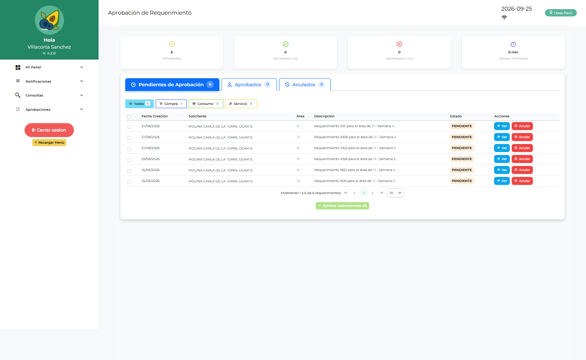

# Manual de Usuario — Admin Logística (ADLOGIST)

| Campo | Valor |
|---|---|
| Código de rol | `ADLOGIST` |
| Nombre | Administrador de Logística (funcional) |
| Pantalla inicial | Dashboard Admin Logística (`/main/dashboard-adlogist`) |
| Consolas | `/administracion` (con `/admin-login`) y `/admin-logistica` |
| Video tutorial | [../video-tutoriales/VIDEO_TUTORIAL_ADLOGIST.html](../video-tutoriales/VIDEO_TUTORIAL_ADLOGIST.html) |

---

## 1. ¿Quién eres?

Eres el **administrador funcional** del módulo. Combinas dos mundos: configuras el sistema (usuarios, áreas, flujos, permisos, menús) y además puedes operar casi todo el flujo logístico (requerimientos, compras, aprobaciones, devoluciones, conformidades).

## 2. Acceso

1. Login de la app → te lleva a **Dashboard Admin Logística**.
2. Consola administrativa: `/admin-logistica/login`.
3. Administración clásica: `/admin-login` → `/administracion`.

## 3. Tu panel de inicio

**Dashboard Admin Logística**: resumen de requerimientos, solicitudes, aprobaciones pendientes, usuarios y estado general del módulo.

## 4. Pantallas disponibles

| Grupo | Pantallas |
|---|---|
| Panel | Dashboards: Admin Logística, Admin Sistema, Logística, Jef. Logística, Jef. Licitaciones, Compras, Finanzas, Operativo, Aprobaciones por Área |
| Configuración | Parámetros, Notificaciones |
| Requerimientos | Requerimientos, Saldo de Requerimiento |
| Compras | Solicitudes de Compra, Consolidación (Req./Compras/Corporativa/Servicios), Cotizaciones, Órdenes de Compra, Solicitudes de Servicio, Órdenes de Servicio, Conformidad de Servicios |
| Almacén | Conformidad de Despacho, Devoluciones de Consumo, Reingresos |
| Aprobaciones | Aprobaciones por Área, Aprobación OC, Aprobación OS |
| Maestros | Ítems, Commodities, Maestro Proveedores, Aprobadores |
| Reportes | Reportes Compras, Requerimientos, Logístico, Aprobaciones Área, Aprobados |

## 5. Consola `/admin-logistica`

Ves **todas las pestañas** igual que TILOGIST, con una diferencia: **no puedes crear usuarios con rol TILOGIST**.

Pestañas clave para tu gestión:

- **Usuarios**: crea/edita usuarios de todos los roles excepto TILOGIST.
- **Áreas / Usuarios por Área / Flujo Aprobación Área**: define qué APLOGIST aprueba cada área.
- **Aprobadores**: asignación de aprobadores por flujo de OC/OS.
- **Permisos por Rol**: ajusta las claves `ADMINLG_MENU_*` de cada rol.
- **Empresa / Parámetros / Formato PDF / Plantillas Almacén / Conformidad**: configuración funcional.
- **Auditoría**: trazabilidad.

## 6. Procedimientos frecuentes

### Aprobar un requerimiento por área (cuando cubres a un jefe)

1. Menú → **Aprobaciones → Aprobaciones por Área**.
2. Filtra por área/estado, abre el requerimiento.
3. Revisa ítems y cantidades → **Aprobar** o **Rechazar** con motivo.

### Aprobar una Orden de Compra

1. **Aprobaciones → Aprobación OC**.
2. Abre la OC, revisa líneas, montos y adjuntos.
3. **Aprobar** o **Rechazar** con comentario. El estado se refleja en Órdenes de Compra.

### Configurar el flujo de aprobación de un área

1. Consola `/admin-logistica` → **Flujo Aprobación Área**.
2. Selecciona el área, define los niveles y el aprobador (APLOGIST) de cada nivel.
3. Guarda y verifica con un requerimiento de prueba.

### Crear usuarios operativos

Consola → **Usuarios** → Nuevo → asigna rol (puedes crear todos excepto TILOGIST).

## 7. Restricciones

- Sin acceso a pantallas físicas de almacén: **Despachos, Recepción, Kardex, Inventario, Listas de Stock, Transferencias, Devoluciones a Proveedores, Evaluación** (esas son de ALLOGIST/LOLOGIST).
- No puedes crear usuarios `TILOGIST`.

## 8. Problemas comunes

| Problema | Solución |
|---|---|
| Necesito ver un despacho | Pide acceso a un usuario ALLOGIST/LOLOGIST o usa reportes |
| Un aprobador no ve pendientes | Verifica en **Usuarios por Área** que esté asignado al área correcta |
| Menú incompleto | Revisa `ITEMS_VISIBLES`/`MENU_JSON` del rol en BD |
