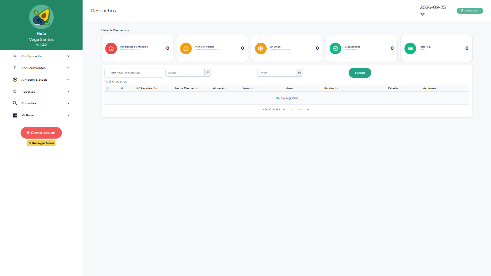

# Manual de Usuario — Almacén (ALLOGIST)

| Campo | Valor |
|---|---|
| Código de rol | `ALLOGIST` |
| Nombre | Personal / Jefe de Almacén |
| Pantalla inicial | Gestión de Despachos (`/main/despachos`) |
| Video tutorial | [../video-tutoriales/VIDEO_TUTORIAL_ALLOGIST.html](../video-tutoriales/VIDEO_TUTORIAL_ALLOGIST.html) |

---

## 1. ¿Quién eres?

Eres el **responsable del almacén**: despachas material, recepcionas mercadería de las OC, mantienes el kardex y el inventario, gestionas transferencias, devoluciones y evalúas proveedores. También actúas como **aprobador de almacén** para devoluciones de consumo.

## 2. Acceso

Login → entras directo a **Gestión de Despachos**.

## 3. Pantallas disponibles

| Grupo | Pantallas |
|---|---|
| Panel | Dashboard Operativo, Dashboard Despacho |
| Configuración | Parámetros, Notificaciones |
| Requerimientos | Requerimientos, Saldo de Requerimiento |
| Almacén | Despachos, Recepción de Mercadería, Conformidad de Despacho, Kardex e Inventario, Gestión de Inventario, Listas de Stock, Transferencias, Devoluciones a Proveedores, Devoluciones de Consumo, Reingresos |
| Proveedores | Maestro Proveedores, Evaluación de Proveedores |
| Reportes | Reporte de Saldos, Reporte de Despachos, Requerimientos, Logístico, Catálogo |

## 4. Procedimientos frecuentes

### Despachar material

1. **Despachos** → lista de requerimientos/listas listos para despacho.
2. Abre el documento, verifica stock disponible.
3. Confirma el despacho → queda pendiente de conformidad por el solicitante.

### Recepcionar una OC

1. **Recepción de Mercadería** → busca la OC aprobada.
2. Registra cantidades, lotes y documentos de la recepción.
3. Confirma → ingresa a stock y se refleja en kardex.

### Gestionar kardex e inventario

- **Kardex**: consulta movimientos por ítem (entradas/salidas/saldos).
- **Gestión de Inventario**: ajustes y conteos.
- **Listas de Stock**: armar listas predefinidas de despacho.
- **Transferencias**: mover stock entre almacenes.

### Procesar devoluciones

- **De consumo**: revisa devoluciones de usuarios → **aprueba/rechaza/anula** (eres Jefe de Almacén).
- **A proveedores**: registra devolución por recepción defectuosa.
- **Reingresos**: procesa material que vuelve al almacén.

### Evaluar proveedores

**Evaluación de Proveedores** → califica criterios (plazo, calidad, documentación) por OC recepcionada.

## 5. Restricciones

- No ves compras, cotizaciones, OC ni aprobaciones por área.
- No gestionas usuarios ni configuración del sistema.

## 6. Problemas comunes

| Problema | Solución |
|---|---|
| No hay stock para despachar | Verifica recepciones pendientes y kardex del ítem |
| Una devolución no aparece | El usuario debe registrarla primero en Devoluciones de Consumo |
| Diferencias en inventario | Usa Gestión de Inventario para ajuste con justificación |
