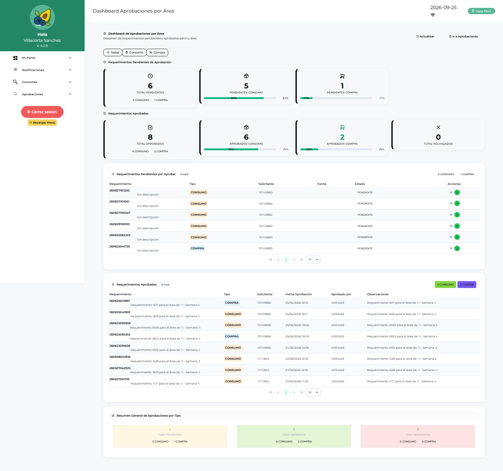

# Manual de Usuario — Aprobador Consumo (APLOGIST)

| Campo | Valor |
|---|---|
| Código de rol | `APLOGIST` |
| Nombre | Aprobador de Consumo / Jefe de Área |
| Pantalla inicial | Dashboard Aprobaciones por Área (`/main/dashboard-aprobaciones-area`) |
| Video tutorial | [../video-tutoriales/VIDEO_TUTORIAL_APLOGIST.html](../video-tutoriales/VIDEO_TUTORIAL_APLOGIST.html) |

---

## 1. ¿Quién eres?

Eres el **jefe de área aprobador**: los requerimientos que crean los usuarios de tu área llegan a tu bandeja para aprobación o rechazo. También apruebas los **reingresos** de material. Sin tu aprobación, el requerimiento no avanza a compras.

## 2. Acceso

Login → **Dashboard Aprobaciones por Área**: contadores de pendientes, aprobados, rechazados y acceso directo a la bandeja.

## 3. Pantallas disponibles

| Pantalla | Qué haces |
|---|---|
| Dashboard Aprobaciones por Área | Resumen de pendientes de tu área |
| Aprobaciones / Aprobaciones por Área | Bandeja: aprobar o rechazar requerimientos |
| Reporte Aprobaciones Área | Historial y trazabilidad de tus decisiones |
| Reporte Requerimientos Aprobados | Consulta de lo ya aprobado |
| Dashboard Operativo | Estado operativo general |
| Conformidad de Despacho | Conformar recepciones |
| Devoluciones de Consumo | Ver devoluciones registradas |
| Reingresos | **Aprobar/rechazar reingresos** (solo tú) |
| Reporte Requerimientos / Logístico / Catálogo | Consultas |

## 4. Procedimientos frecuentes

### Aprobar un requerimiento

1. **Aprobaciones por Área** → lista de pendientes de tu(s) área(s).
2. Abre el requerimiento: revisa solicitante, ítems, cantidades, centro de costo, adjuntos.
3. Decide:
   - **Aprobar** → pasa a logística para consolidación/compra.
   - **Rechazar** → indica el motivo; vuelve al solicitante.

### Aprobar un reingreso

1. **Reingresos** → solicitudes de material que vuelve al almacén.
2. Revisa ítems y estado → **Aprobar** o **Rechazar**.

### Revisar tu historial

**Reporte Aprobaciones Área** → filtra por fecha/estado → exporta si necesitas respaldo.

## 5. Restricciones

- No creas requerimientos (tu rol es aprobar).
- No ves compras, cotizaciones, órdenes ni almacén.
- Solo ves requerimientos de **las áreas que te fueron asignadas** (lo configura el admin en *Usuarios por Área*).

## 6. Problemas comunes

| Problema | Solución |
|---|---|
| No veo requerimientos de un área | Pide al administrador (ADLOGIST/TILOGIST) asignarte esa área en **Usuarios por Área** |
| Rechacé por equivocación | El solicitante debe generar un nuevo requerimiento o pedir revisión a logística |
| El contador no baja | Refresca la página; el contador se actualiza al cargar |
