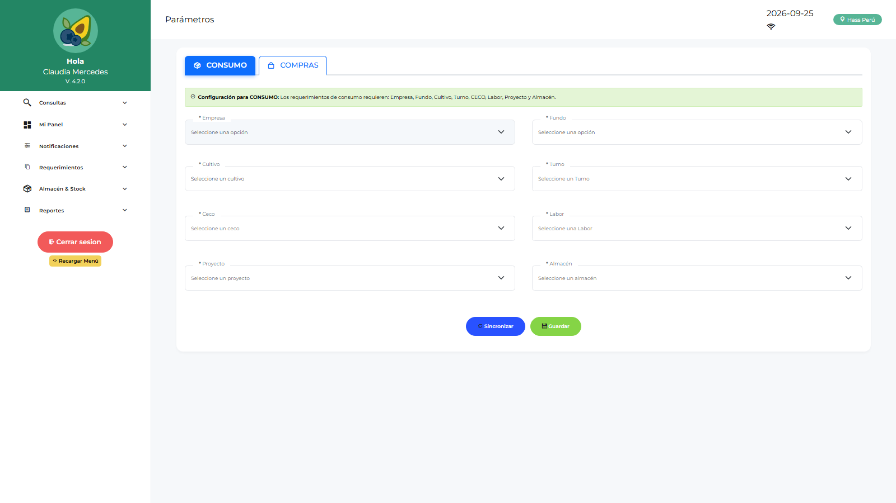

# Manual de Usuario — Operador Licitaciones (EMLOGIST)

| Campo | Valor |
|---|---|
| Código de rol | `EMLOGIST` |
| Nombre | Operador de Licitaciones / Empaque |
| Pantalla inicial | Dashboard Logística (configurar menú a `dashboard-oplogist` recomendado) |
| Video tutorial | [../video-tutoriales/VIDEO_TUTORIAL_EMLOGIST.html](../video-tutoriales/VIDEO_TUTORIAL_EMLOGIST.html) |

---

## 1. ¿Quién eres?

Eres el **operador del área de empaque/licitaciones**: creas requerimientos de materiales e insumos de empaque, haces seguimiento a tus solicitudes, conformas servicios y registras devoluciones/reingresos.

## 2. Acceso

1. Login → el sistema te dirige a tu dashboard.
2. Tu menú se define por configuración (acordeón). Si no ves opciones, pide al administrador que configure `MENU_JSON` para EMLOGIST.

## 3. Pantallas disponibles

| Pantalla | Qué haces |
|---|---|
| Dashboard Operativo (Mis Requerimientos) | Estado de tus requerimientos |
| Parámetros | Sincronizar maestras para trabajar offline |
| Notificaciones | Avisos de saldos y pendientes |
| Requerimientos | Crear solicitudes: ítems, commodities, activo fijo, activo menor |
| Saldo de Requerimiento | Ver saldos pendientes |
| Conformidad de Servicios | Conformar servicios recibidos |
| Conformidad de Despacho | Confirmar recepción de lo despachado |
| Devoluciones de Consumo | Devolver material no usado |
| Reingresos | Reingresar material al almacén |
| Reporte Requerimientos / Logístico / Catálogo | Consultas abiertas |

## 4. Procedimientos frecuentes

### Crear un requerimiento

1. Primero: **Parámetros → Sincronizar** (descarga maestras: ítems, almacenes, centros de costo, labores…).
2. **Requerimientos → Nuevo** → elige tipo: Ítem / Commodity / Activo Fijo / Activo Menor.
3. Completa cabecera (área, almacén, fecha, glosa) y agrega líneas con cantidades.
4. Guarda → queda **pendiente de sincronizar** si estás offline; sincroniza en cuanto tengas red.
5. Tu jefe de área (APLOGIST) lo aprueba → luego logística lo consolida.

### Conformar un despacho

**Conformidad de Despacho** → selecciona el despacho recibido → confirma cantidades conformes u observa diferencias.

### Devolver material

**Devoluciones de Consumo** → selecciona el ítem y cantidad a devolver → el almacén/jefatura lo procesa como **Reingreso**.

## 5. Restricciones

- No gestionas compras, cotizaciones ni órdenes.
- No apruebas nada; no ves almacén ni administración.

## 6. Problemas comunes

| Problema | Solución |
|---|---|
| “Falta configurar” al crear requerimiento | Ve a Parámetros y sincroniza la configuración primero |
| No puedo cerrar sesión | Tienes requerimientos sin sincronizar → sincroniza desde Parámetros |
| El menú sale vacío | Pide a TI/Admin configurar `MENU_JSON` para EMLOGIST |
