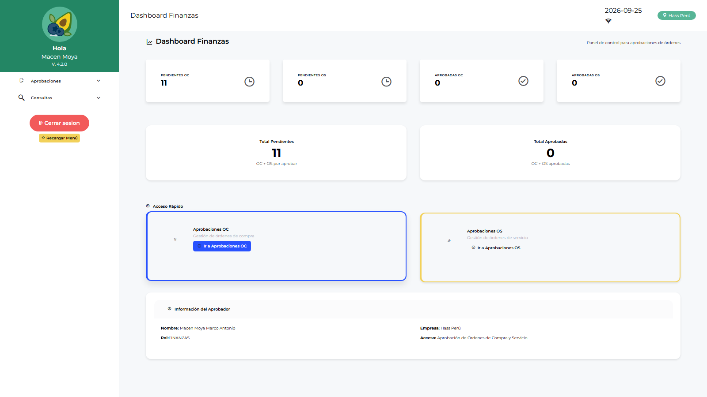

# Manual de Usuario — Finanzas (FINANZAS)

| Campo | Valor |
|---|---|
| Código de rol | `FINANZAS` |
| Nombre | Área de Finanzas |
| Pantalla inicial | Dashboard Finanzas (`/main/dashboard-finanzas`) |
| Video tutorial | [../video-tutoriales/VIDEO_TUTORIAL_FINANZAS.html](../video-tutoriales/VIDEO_TUTORIAL_FINANZAS.html) |

---

## 1. ¿Quién eres?

Eres el **control financiero** del proceso de compras: apruebas o rechazas las **Órdenes de Compra** y las **Órdenes de Servicio** según presupuesto. Tu alcance es puntual y de alto impacto.

## 2. Acceso

Login → **Dashboard Finanzas**: montos pendientes de aprobación, órdenes por estado, indicadores de gasto.

## 3. Pantallas disponibles

| Pantalla | Qué haces |
|---|---|
| Dashboard Finanzas | Panel de control financiero |
| Aprobación OC | Aprobar/rechazar órdenes de compra |
| Aprobación OS | Aprobar/rechazar órdenes de servicio |
| Reporte Requerimientos / Logístico / Catálogo | Consultas abiertas |

## 4. Procedimientos frecuentes

### Aprobar una Orden de Compra

1. Menú → **Aprobaciones → Aprobación OC**.
2. Lista de OC pendientes → abre la orden.
3. Revisa: proveedor, líneas, cantidades, **montos totales**, moneda, adjuntos (cotizaciones, respaldo presupuestal).
4. **Aprobar** → la OC queda lista para emisión/recepción.
   **Rechazar** → indica motivo → regresa a logística.

### Aprobar una Orden de Servicio

En **Aprobación OS** revisa el detalle del servicio, contrato y monto → aprueba o rechaza con comentario.

## 5. Restricciones

- No ves requerimientos, compras operativas, almacén ni administración.
- Solo decides sobre órdenes; no las editas.

## 6. Problemas comunes

| Problema | Solución |
|---|---|
| No aparece una OC que debía llegar | Verifica con logística que fue enviada a aprobación y que el flujo incluye FINANZAS |
| Necesito ver el detalle de la SC origen | Abre la OC → adjuntos/trazabilidad; o pide el reporte a LOLOGIST |
