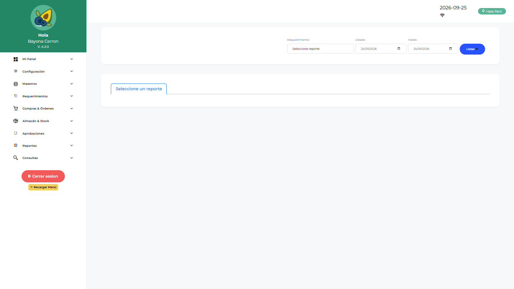
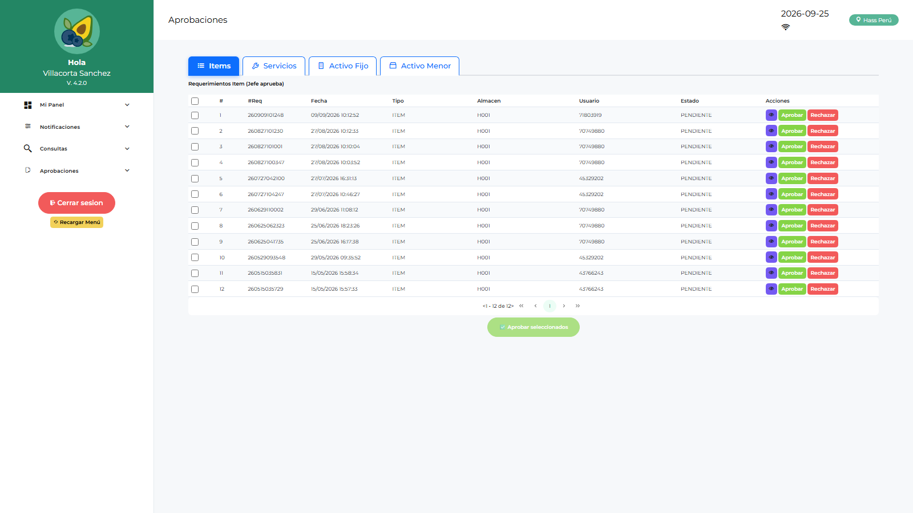

# Manual de Usuario — Jefe Licitaciones (JEMLOGIST)

| Campo | Valor |
|---|---|
| Código de rol | `JEMLOGIST` |
| Nombre | Jefe de Licitaciones / Empaque |
| Pantalla inicial | Dashboard Jef. Licitaciones (`/main/dashboard-jemlogist`) |
| Video tutorial | [../video-tutoriales/VIDEO_TUTORIAL_JEMLOGIST.html](../video-tutoriales/VIDEO_TUTORIAL_JEMLOGIST.html) |

---

## 1. ¿Quién eres?

Eres la **jefatura del área de licitaciones/empaque**. Tu función principal es **aprobar órdenes de compra y de servicio** dentro del flujo, supervisar el dashboard operativo y dar conformidad de servicios.

## 2. Acceso

Login → **Dashboard Jef. Licitaciones**: indicadores de OC/OS pendientes de tu aprobación, montos y estado de licitaciones.

## 3. Pantallas disponibles

| Pantalla | Qué haces |
|---|---|
| Dashboard Jef. Licitaciones | Tu panel de control |
| Dashboard Operativo | Estado de requerimientos operativos |
| Dashboard Finanzas | Visión financiera de órdenes |
| Aprobación OC | Aprobar/rechazar órdenes de compra |
| Aprobación OS | Aprobar/rechazar órdenes de servicio |
| Conformidad de Servicios | Conformar servicios ejecutados |
| Devoluciones de Consumo | Revisión de devoluciones |
| Reporte Requerimientos / Logístico / Catálogo | Consultas abiertas |

## 4. Procedimientos frecuentes

### Aprobar una Orden de Compra

1. Menú → **Aprobaciones → Aprobación OC**.
2. Lista de OC pendientes → abre la orden.
3. Revisa proveedor, líneas, montos y adjuntos (cotizaciones, PDF).
4. **Aprobar** (avanza en el flujo) o **Rechazar** (con motivo → vuelve a logística).

### Aprobar una Orden de Servicio

Mismo flujo en **Aprobación OS**, revisando el detalle del servicio y la solicitud origen.

### Conformidad de servicio ejecutado

1. **Conformidad de Servicios** → selecciona la OS ejecutada.
2. Registra la conformidad (cantidades/fechas) → queda lista para cierre.

## 5. Restricciones

- No creas requerimientos ni gestionas compras/cotizaciones (eso es LOLOGIST).
- No accedes a almacén, aprobaciones por área ni administración.

## 6. Problemas comunes

| Problema | Solución |
|---|---|
| No veo una OC pendiente | Verifica que LOLOGIST la haya enviado a aprobación y que el flujo te incluya |
| Rechacé por error | Contacta a ADLOGIST/TILOGIST para revisar el estado y reenviar |
