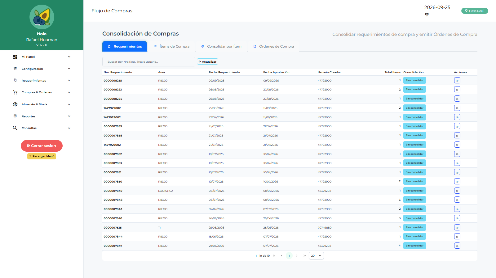

# Manual de Usuario — Jefe Logística (JLOLOGIST)

| Campo | Valor |
|---|---|
| Código de rol | `JLOLOGIST` |
| Nombre | Jefe de Logística |
| Pantalla inicial | Dashboard Logística (`/main/dashboard-logistica`) |
| Menú | Propio (hardcodeado, tipo acordeón) — no usa `MENU_JSON` |
| Consola | `/admin-logistica` con menú reducido |
| Video tutorial | [../video-tutoriales/VIDEO_TUTORIAL_JLOLOGIST.html](../video-tutoriales/VIDEO_TUTORIAL_JLOLOGIST.html) |

---

## 1. ¿Quién eres?

Eres la **jefatura de logística**: supervisas el ciclo completo — apruebas requerimientos por área, apruebas órdenes de compra y servicio, gestionas compras, cotizaciones y consolidaciones. Además puedes dar de alta usuarios operativos.

> Tu menú es especial: se muestra como **acordeón** con grupos (Panel, Configuración, Requerimientos, Compras, Almacén, Aprobaciones, Reportes, Consultas) y se define en el sistema, no por BD.

## 2. Acceso

1. Login → entras a **Dashboard Logística** (35_dashboard_logistica.png).
2. Consola: `/admin-logistica/login` → ves pestañas operativas (Dashboard, Bandeja, Aprobar Consumo, Maestros, Proveedores, Usuarios, Formato PDF).

## 3. Tu menú (acordeón)

| Grupo | Ítems |
|---|---|
| Mi Panel | Dashboard Jef. Logística, Mi Dashboard, Dashboard Logística, Dashboard Compras, Dashboard Jef. Licitaciones, Dashboard Finanzas |
| Configuración | Notificaciones, Parámetros |
| Requerimientos | Requerimientos, Saldo de Requerimiento |
| Compras & Órdenes | Solicitudes de Compra, Órdenes de Compra, Consolidaciones, Solicitudes/Órdenes de Servicio, Cotizaciones, Conformidad de Servicios |
| Almacén & Stock | Conformidad de Despacho, Devoluciones de Consumo |
| Aprobaciones | Aprobación OC, Aprobación OS, Aprobaciones por Área, Dashboard Aprobaciones |
| Reportes | Reportes Compras, Requerimientos, Aprobaciones Área, Aprobados, Logístico |
| Consultas | Catálogo de Ítems |

## 4. Procedimientos frecuentes

### Aprobar requerimientos de un área

1. **Aprobaciones → Aprobaciones por Área**.
2. Abre el requerimiento pendiente, revisa ítems/cantidades.
3. **Aprobar** o **Rechazar** indicando motivo.

### Consolidar y generar una Orden de Compra

1. **Compras → Consolidación Compras**: selecciona líneas aprobadas.
2. Genera la **Solicitud de Compra** o cotiza primero en **Cotizaciones**.
3. En **Órdenes de Compra** genera la OC, adjunta documentos y envía a aprobación.

### Aprobar una OC / OS

1. **Aprobaciones → Aprobación OC** (u OS).
2. Revisa líneas, proveedor, montos y PDF de la orden.
3. **Aprobar** o **Rechazar** con comentario → notifica al siguiente nivel.

### Crear un usuario operativo

Consola `/admin-logistica` → **Usuarios** → Nuevo. Roles disponibles para ti: `LOLOGIST`, `EMLOGIST`, `ALLOGIST`, `OPLOGIST`, `APLOGIST`.

> No verás usuarios con rol JLOLOGIST ni ADLOGIST en las listas — es por seguridad.

## 5. Restricciones

- No accedes a despachos, recepción, kardex ni reingresos (rol de almacén).
- En la consola no ves las pestañas de configuración (Áreas, Empresa, Parámetros, Auditoría, Permisos) salvo que un admin te las habilite con claves `ADMINLG_*`.
- No ves Aprobar SC / Aprobar SS en la consola por defecto.

## 6. Problemas comunes

| Problema | Solución |
|---|---|
| No veo la opción de consolidar | Verifica que el requerimiento esté aprobado por el área (APLOGIST) |
| La OC no pasa a siguiente estado | Falta aprobación de Finanzas/Gerencia según el flujo configurado |
| Quiero ver el stock | El kardex es de ALLOGIST/LOLOGIST; usa Reporte de Saldos si está disponible o solicita acceso |
