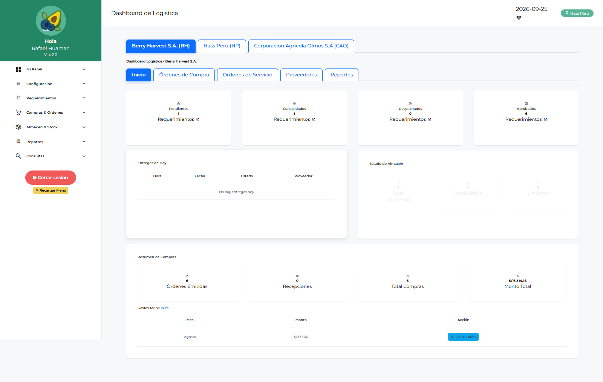
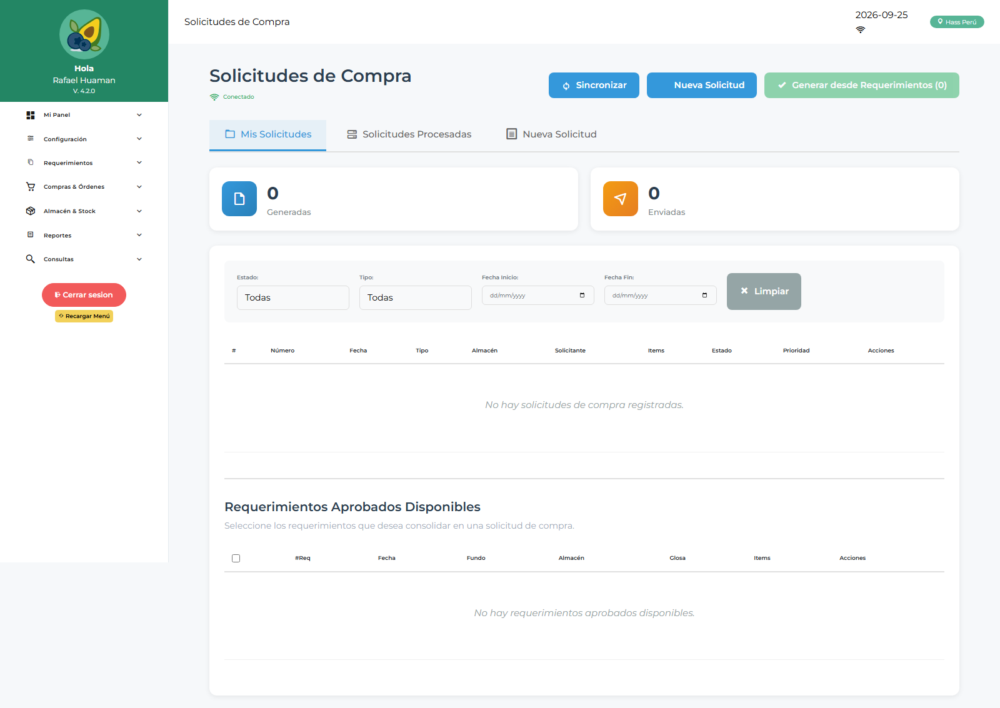
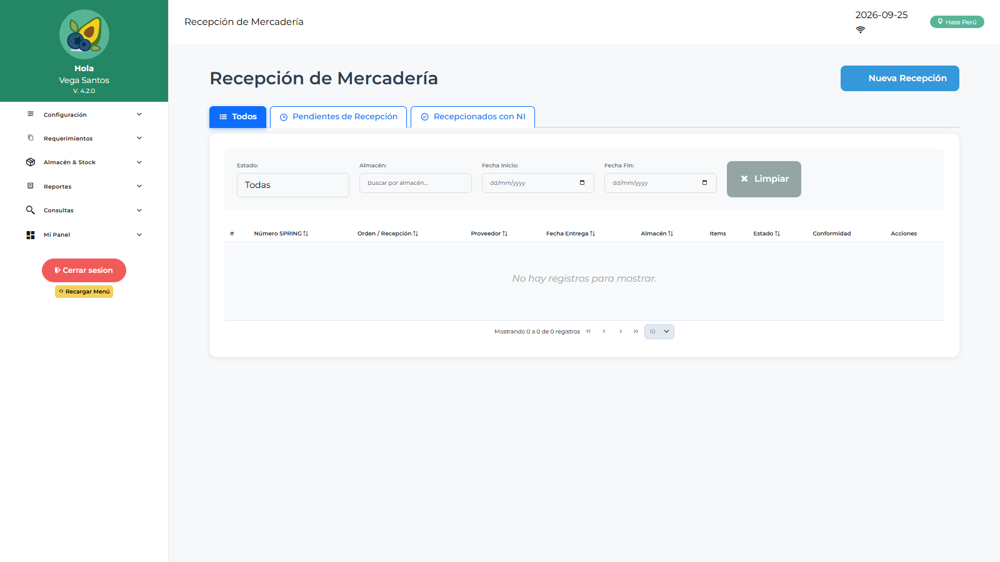

# Manual de Usuario — Operador Logística (LOLOGIST)

| Campo | Valor |
|---|---|
| Código de rol | `LOLOGIST` |
| Nombre | Operador de Logística |
| Pantalla inicial | Dashboard Logística (`/main/dashboard-logistica`) |
| Video tutorial | [../video-tutoriales/VIDEO_TUTORIAL_LOLOGIST.html](../video-tutoriales/VIDEO_TUTORIAL_LOLOGIST.html) |

---

## 1. ¿Quién eres?

Eres el **rol operativo más completo**: ejecutas todo el ciclo de compras (consolidación, cotización, SC, OC/SS/OS) **y** operas el almacén (despachos, recepción, kardex, inventario, transferencias, devoluciones). No apruebas — ejecutas.

## 2. Acceso

Login → **Dashboard Logística**: vista de requerimientos aprobados pendientes de consolidar, compras en curso, OC por estado y alertas.

## 3. Pantallas disponibles

| Grupo | Pantallas |
|---|---|
| Panel | Dashboard Logística, Jef. Logística, Jef. Licitaciones, Compras, Operativo, Despacho |
| Configuración | Parámetros, Notificaciones |
| Requerimientos | Requerimientos, Saldo de Requerimiento |
| Compras | Solicitudes de Compra, Consolidación Requerimientos/Compras/Corporativa/Servicios, Cotizaciones, Órdenes de Compra, Solicitudes de Servicio, Órdenes de Servicio, Conformidad de Servicios |
| Almacén | Despachos, Recepción de Mercadería, Conformidad de Despacho, Kardex, Gestión de Inventario, Listas de Stock, Transferencias, Devoluciones a Proveedores y de Consumo, Reingresos, Evaluación de Proveedores |
| Maestros | Maestro Proveedores, Catálogo de Ítems |
| Reportes | Reportes Compras, Requerimientos, Saldos, Despachos, Logístico |

## 4. Procedimientos frecuentes

### Del requerimiento aprobado a la Orden de Compra

1. **Consolidación de Requerimientos** → agrupa líneas aprobadas.
2. **Solicitudes de Compra** → genera la SC con adjuntos.
3. **Cotizaciones** → registra cotizaciones de proveedores y selecciona la ganadora.
4. **Órdenes de Compra** → genera la OC, envía a aprobación (JLOLOGIST/JEMLOGIST/FINANZAS/GERENTE).
5. Sigue el estado en **Órdenes de Compra** hasta aprobada.

### Consolidación corporativa

**Consolidación Corporativa** → combina requerimientos de varias empresas/fundos en una sola compra para mejorar precio.

### Recepcionar mercadería

1. **Recepción de Mercadería** → busca la OC aprobada.
2. Ingresa cantidades recibidas, lotes/fechas si aplica, documentos.
3. Confirma → actualiza stock y kardex automáticamente.

### Despachar a un solicitante

**Despachos** → selecciona requerimiento/lista de stock → confirma salida → queda pendiente de **Conformidad de Despacho** por el solicitante.

### Otros flujos de almacén

- **Transferencias**: mover stock entre almacenes.
- **Devoluciones a Proveedores**: registrar devolución por recepción con problemas.
- **Devoluciones de Consumo**: registrar material devuelto por usuarios.
- **Evaluación de Proveedores**: calificar desempeño del proveedor.

## 5. Restricciones

- No apruebas requerimientos por área ni OC/OS (es jefatura/finanzas/gerencia).
- No gestionas usuarios ni configuración.

## 6. Problemas comunes

| Problema | Solución |
|---|---|
| Una línea no aparece para consolidar | Debe estar aprobada por el área (APLOGIST) |
| No puedo emitir la OC | Revisa que la cotización ganadora esté seleccionada |
| Stock no cuadra | Revisa Kardex → movimientos; verifica recepciones/despachos pendientes |
