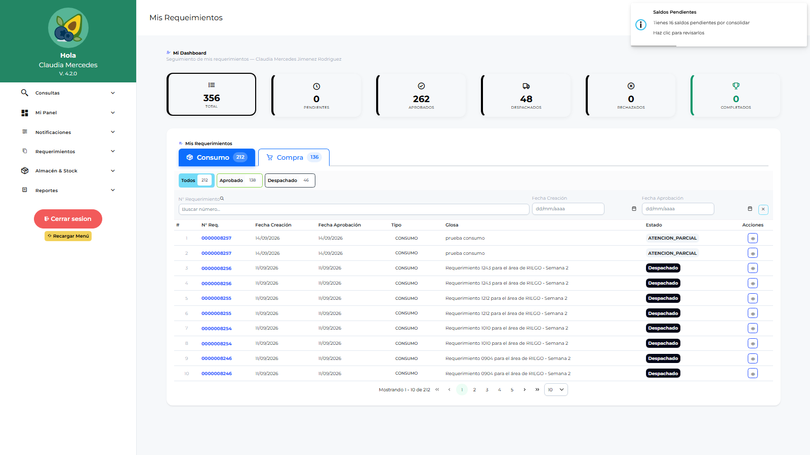

# Manual de Usuario — Operativo Campo (OPLOGIST)

| Campo | Valor |
|---|---|
| Código de rol | `OPLOGIST` |
| Nombre | Operativo de Campo / Solicitante |
| Pantalla inicial | Mis Requerimientos (`/main/dashboard-oplogist`) |
| Video tutorial | [../video-tutoriales/VIDEO_TUTORIAL_OPLOGIST.html](../video-tutoriales/VIDEO_TUTORIAL_OPLOGIST.html) |

---

## 1. ¿Quién eres?

Eres el **usuario de campo**: solicitas materiales, insumos, activos y servicios desde tu fundo/área. Trabajas incluso **sin conexión**: todo se guarda localmente y se sincroniza después.

## 2. Acceso

Login → **Mis Requerimientos**: panel con el estado de tus solicitudes (pendientes, aprobadas, en compra, despachadas).

## 3. Pantallas disponibles

| Pantalla | Qué haces |
|---|---|
| Mis Requerimientos (dashboard) | Estado de tus solicitudes |
| Parámetros | **Sincronizar maestras** — paso obligatorio antes de crear requerimientos |
| Notificaciones | Avisos del sistema |
| Requerimientos | Crear solicitudes de ítems, commodities, activos fijos, activos menores, transferencias, consumo |
| Conformidad de Despacho | Confirmas que recibiste el material despachado |
| Conformidad de Servicios | Confirmas que el servicio se ejecutó |
| Devoluciones de Consumo | Devuelves material no utilizado |
| Reingresos | Solicitas reingreso de material al almacén |
| Reporte Requerimientos / Logístico / Catálogo | Consultas |

## 4. Procedimientos frecuentes

### Preparar tu equipo (una vez / periódico)

1. Menú → **Parámetros**.
2. **Sincronizar**: descarga empresas, fundos, almacenes, áreas, cultivos, centros de costo, labores, ítems…
3. Sin esto, la pantalla Requerimientos te pedirá sincronizar primero.

### Crear un requerimiento

1. **Requerimientos → Nuevo**.
2. Tipo: Ítem / Commodity / Activo Fijo / Activo Menor / Transferencia / Consumo.
3. Cabecera: área, almacén destino, fecha requerida, glosa.
4. Agrega líneas (ítem, cantidad, unidad, centro de costo/labor si aplica).
5. **Guardar** → queda en estado “pendiente de sincronizar” si no hay red.
6. **Sincroniza** cuando tengas conexión → tu requerimiento pasa a aprobación del jefe de área (APLOGIST).

### Confirmar recepción (conformidad)

Cuando el almacén despache tu pedido: **Conformidad de Despacho** → abre el despacho → confirma cantidades recibidas u observa diferencias.

### Devolver o reingresar material

- **Devoluciones de Consumo**: material que no usaste y devuelves.
- **Reingresos**: material que retorna al almacén (requiere aprobación del jefe de área).

## 5. Restricciones

- Solo ves **tus propios flujos**: no hay compras, almacén, aprobaciones ni administración.

## 6. Problemas comunes

| Problema | Solución |
|---|---|
| “Falta configurar” | Sincroniza en Parámetros primero |
| No puedo cerrar sesión | Tienes requerimientos sin sincronizar — sincronízalos primero |
| Mi requerimiento no avanza | Revisa su estado: debe estar sincronizado y luego aprobado por tu jefe de área |
| Trabajé sin internet | Normal: todo se guardó local; sincroniza al recuperar conexión |
