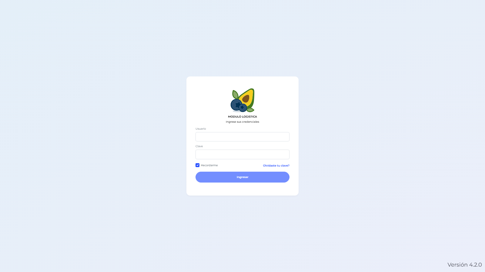
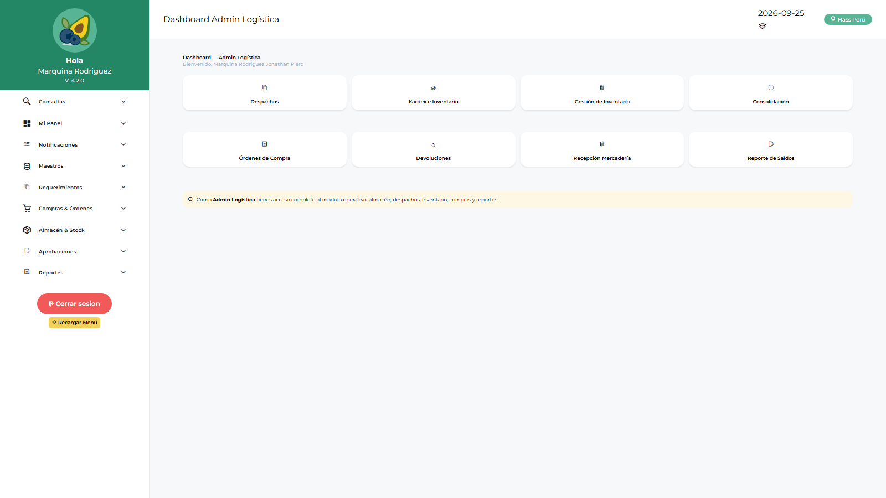
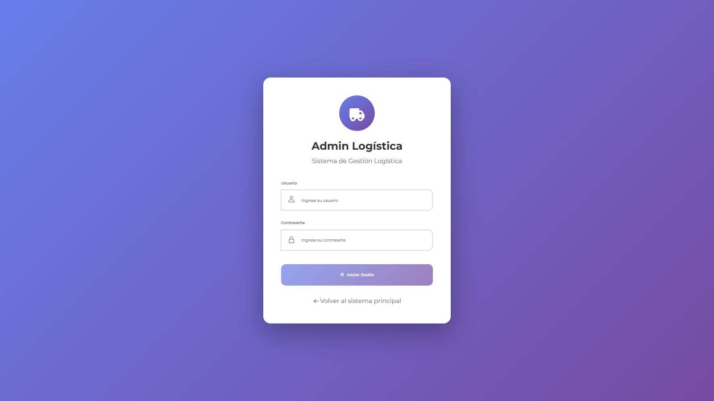
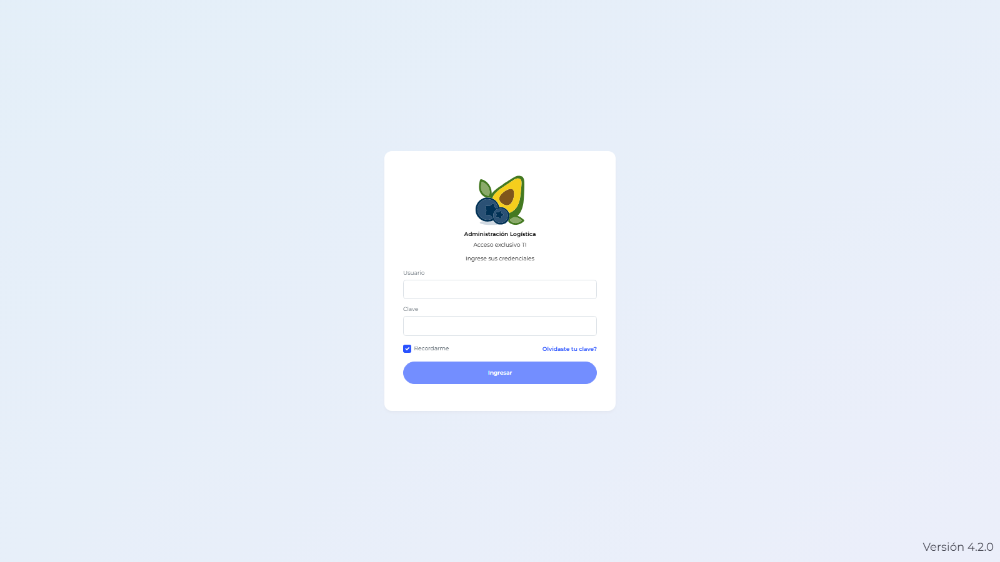

# Manual de Usuario — Admin Sistema (TILOGIST)

| Campo | Valor |
|---|---|
| Código de rol | `TILOGIST` |
| Nombre | Admin Sistema / TI Logística |
| Pantalla inicial | Dashboard Admin Sistema (`/main/dashboard-tilogist`) |
| Consolas | `/administracion` (con `/admin-login`) y `/admin-logistica` |
| Video tutorial | [../video-tutoriales/VIDEO_TUTORIAL_TILOGIST.html](../video-tutoriales/VIDEO_TUTORIAL_TILOGIST.html) |

---

## 1. ¿Quién eres?

Eres el **administrador técnico** de la plataforma Logística. Tu rol es el de mayor alcance: configuras usuarios de todos los roles, permisos, menús, parámetros, correo, plantillas, branding y auditoría.

## 2. Acceso

1. Ingresa a la URL de la aplicación → pantalla de login.
2. Escribe tu usuario y contraseña corporativos.
3. El sistema te lleva automáticamente al **Dashboard Admin Sistema**.

Para entrar a la consola de administración logística, abre `/admin-logistica/login` e inicia sesión con tu cuenta.

## 3. Tu panel de inicio

El **Dashboard Admin Sistema** muestra indicadores generales: usuarios activos, empresas configuradas, estado de sincronización y accesos rápidos a la administración.

## 4. Pantallas disponibles

| Grupo | Pantalla | Qué haces ahí |
|---|---|---|
| Panel | Dashboard Admin Sistema / Admin Logística / Logística / Jef. Logística / Jef. Licitaciones / Compras / Finanzas / Operativo | Indicadores y supervisión |
| Configuración | Parámetros | Sincronizar maestras y configuración local |
| Configuración | Notificaciones | Ver avisos de saldos pendientes |
| Requerimientos | Requerimientos / Saldo | Crear y revisar requerimientos (testing/soporte) |
| Compras | Solicitudes de Compra, Consolidaciones, Cotizaciones, OC | Supervisión del flujo de compras |
| Compras | Solicitudes y Órdenes de Servicio, Conformidad | Supervisión del flujo de servicios |
| Almacén | Devoluciones de Consumo, Conformidad de Despacho | Soporte del flujo de consumo |
| Aprobaciones | Aprobación OC / OS | Soporte en aprobación de órdenes |
| Maestros | Ítems, Commodities, Proveedores, Aprobadores | Mantenimiento de catálogos |
| Reportes | Reportes de Compras, Requerimientos, Logístico | Consulta y exportación |

## 5. Consola `/admin-logistica` — todas las pestañas

Como TILOGIST ves **todas** las pestañas:

- **Dashboard / Bandeja / Aprobar Consumo / Aprobar SC / Aprobar SS** — gestión de aprobaciones.
- **Maestros / Gestión Proveedores** — catálogos.
- **Usuarios** — crear y editar usuarios de **cualquier rol** (eres el único que puede crear otros TILOGIST).
- **Áreas / Usuarios por Área / Flujo Aprobación Área** — estructura organizacional y flujos de aprobación.
- **Formato PDF / Empresa / Parámetros / Plantillas Almacén** — configuración por empresa.
- **Incremento Cantidad OC** — autorizar incrementos de cantidad en OC.
- **Aprobadores** — asignar aprobadores por flujo.
- **Auditoría** — trazabilidad de acciones.
- **Conformidad Servicio** — configuración de la conformidad.
- **Permisos por Rol** — asignar/quitar las claves `ADMINLG_MENU_*` a cada rol.
- **Migrar Adjuntos** — utilidad de migración de adjuntos a servidor.

## 6. Módulo `/administracion` (clásico)

Acceso previo por `/admin-login`. Incluye: usuarios, roles, áreas, perfiles, flujos, aprobadores, usuarios por área, versión de API, e-mail de proveedores, SMTP, plantillas de correo y PDF, colores, permisos de roles, menús dinámicos y plantillas de menú, empresas, branding y sincronización.

## 7. Procedimientos frecuentes

### Crear un usuario nuevo

1. Entra a `/admin-logistica` → pestaña **Usuarios**.
2. Clic en **Nuevo usuario**.
3. Completa datos y selecciona el rol (`idrol`). Puedes asignar **varios roles** separados por coma (ej. `LOLOGIST,ALLOGIST`).
4. Guarda. El usuario ya puede iniciar sesión en la app operativa.

### Configurar el menú de un rol

1. Pestaña **Permisos por Rol** → selecciona el rol.
2. O desde BD: tabla `LOGISTICA_ConfiguracionPermiso`, claves `MENU_TYPE`, `MENU_JSON`, `ITEMS_VISIBLES`, `LAYOUT_ACCORDION`.
3. Guarda e informa al usuario que recargue la página (el menú se recarga automáticamente por evento `storage`).

### Revisar auditoría

Pestaña **Auditoría** → filtra por usuario, fecha o acción.

## 8. Restricciones

- No ves **aprobaciones por área** ni **reingresos** (esos guards solo admiten APLOGIST/ADLOGIST/JLOLOGIST y roles operativos). Para esos flujos usa una cuenta ADLOGIST.
- No ves pantallas físicas de almacén (despachos, kardex, recepción) con el rol TILOGIST puro.

## 9. Problemas comunes

| Problema | Solución |
|---|---|
| Un usuario no ve un menú | Revisa `LOGISTICA_ConfiguracionPermiso` para su `idrol` o asígnale la clave en Permisos por Rol |
| No puedo cerrar sesión | Hay requerimientos sin sincronizar: ve a Parámetros → Sincronizar |
| Cambios de menú no se ven | Pedir al usuario cerrar sesión y volver a entrar, o usar F5 |
